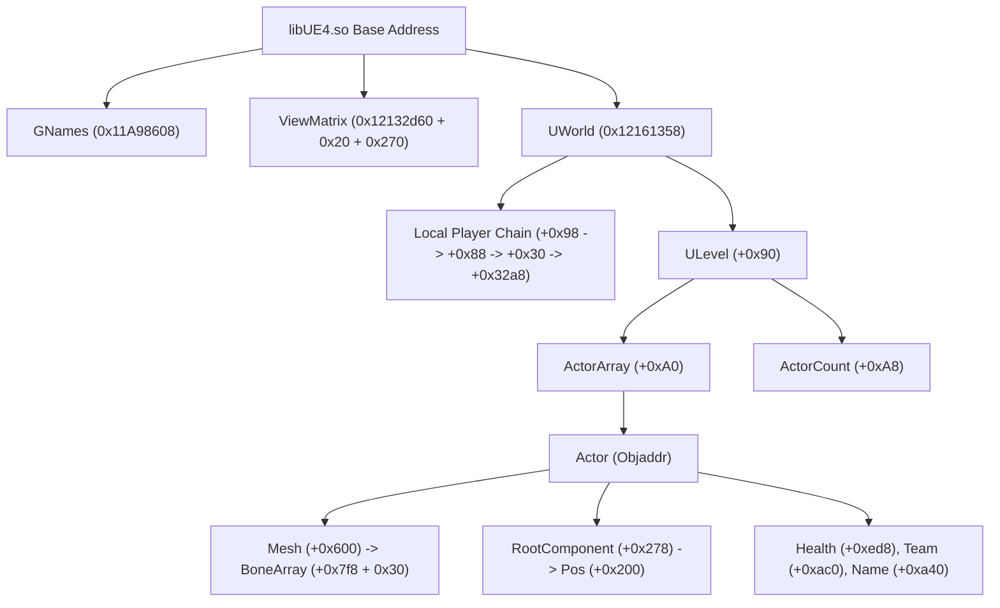
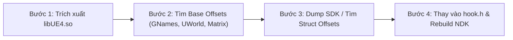

# Báo Cáo Kỹ Thuật: Danh Mục Thành Phần & Offset Cần Cập Nhật Khi Game Update (UE4 Android)

Tài liệu này tổng hợp toàn bộ các thành phần nhị phân, cấu trúc dữ liệu Unreal Engine 4 (UE4) và các offset cần rà soát/cập nhật khi game PUBG Mobile / Peacekeeper Elite ra mắt phiên bản mới.

---

## 1. Bản Đồ File Mã Nguồn Chứa Offset

Toàn bộ các offset trong dự án được đặt cố định tại 2 file chính:
- [src/Android_draw/hook.h](file:///c:/Users/hassk/Music/jni/src/Android_draw/hook.h): Quản lý 95% offset đọc dữ liệu UE4 (GNames, UWorld, Actor, Bone, Equipment).
- [src/Android_draw/其他.h](file:///c:/Users/hassk/Music/jni/src/Android_draw/其他.h): Quản lý ma trận camera (`ViewMatrix`) tại dòng 113 và hàm chiếu `WorldToScreen`.



---

## 2. Bảng Tổng Hợp Chi Tiết Offset Cần Cập Nhật

### Nhóm 1: Base Engine Offsets (Cấp Module `libUE4.so`)
Các offset này thay đổi mỗi khi nhà phát triển recompile game binary:

| Tên Thành Phần | Offset Hiện Tại | Vị Trí Code | Ý Nghĩa / Cách Dùng |
| :--- | :--- | :--- | :--- |
| **GNames** | `0x11A98608` | `hook.h:6` | Bảng tên chuỗi toàn cục của UE4, dùng để nhận diện class, tên vật phẩm, bot/xe/súng |
| **UWorld** | `0x12161358` | `hook.h:7` | Con trỏ thế giới gốc, là điểm bắt đầu của mọi chuỗi truy xuất thực thể |
| **ViewMatrix** | `0x12132d60` | `其他.h:113` | Ma trận góc nhìn 4x4 dùng để chiếu tọa độ 3D sang 2D màn hình (`WorldToScreen`) |

> [!IMPORTANT]
> Khi game nâng cấp phiên bản (ví dụ từ v3.x sang v3.x+1), **3 offset cấp module này chắc chắn 100% thay đổi** do kích thước file `.text` và cấu trúc link binary thay đổi.

---

### Nhóm 2: Chuỗi Con Trỏ Bản Thân (Local Player / Self)

| Tên Thuộc Tính | Offset / Pointer Chain Hiện Tại | Vị Trí Code | Ghi Chú |
| :--- | :--- | :--- | :--- |
| **LocalPlayer Pointer** | `[[[[[UWorld] + 0x98] + 0x88] + 0x30] + 0x32a8]` | `hook.h:11` | Chuỗi 5 cấp từ UWorld -> GameInstance -> LocalPlayerController -> Pawn |
| **MyTeam** | `Oneself + 0xac0` | `hook.h:12` | ID đội của người chơi (dùng để lọc đồng đội, không vẽ ESP) |
| **MyPos** | `[Oneself + 0x278] + 0x200` | `hook.h:13` | Tọa độ 3D `(X, Y, Z)` của nhân vật chính |
| **FOV** | `[[Oneself + 0x5588] + 0x608] + 0x630` | `hook.h:15` | Góc nhìn camera (Field of View) |
| **IsFiring** | `Oneself + 0x23e0` | `hook.h:16` | Trạng thái đang bóp cò (phục vụ tự động ghìm tâm / tự ngắm) |
| **IsAiming** | `Oneself + 0x1668` | `hook.h:17` | Trạng thái đang bật ống ngắm (ADS) |
| **Angle (Góc quay)**| `Oneself + 0x1a8` | `hook.h:18` | Hướng nhìn mặt phẳng 2D của nhân vật |

---

### Nhóm 3: Duyệt Mảng Thực Thể (World & Actor Traversal)

| Tên Thuộc Tính | Offset | Vị Trí Code | Ghi Chú |
| :--- | :--- | :--- | :--- |
| **ULevel** | `UWorld + 0x90` | `hook.h:8` | Bản đồ hiện tại |
| **ActorArray** | `ULevel + 0xA0` | `hook.h:9` | Con trỏ tới mảng thực thể `TArray<AActor*>` |
| **ActorCount** | `ULevel + 0xA8` | `hook.h:10` | Số lượng Actor hiện có trong Level |
| **Actor Pointer** | `ActorArray + 8 * i` | `hook.h:21` | Địa chỉ từng thực thể (mỗi con trỏ 8 bytes trên arm64) |

---

### Nhóm 4: Dữ Liệu Nhân Vật Kẻ Địch (Enemy Actor Attributes)

| Thuộc Tính | Offset Hiện Tại | Vị Trí Code | Cơ Chế Nhận Diện / Kiểm Tra |
| :--- | :--- | :--- | :--- |
| **RootComponent** | `Objaddr + 0x278` | `hook.h:24` | Chứa vị trí và hướng xoay không gian của Actor |
| **Tọa độ (Pos)** | `RootComponent + 0x200` | `hook.h:49` | Tọa độ 3D `Vec3` của địch |
| **Trạng Thái (State)**| `Objaddr + 0x1538` | `hook.h:33` | Kiểm tra còn sống, đang gục hay đã chết |
| **Team ID** | `Objaddr + 0xac0` | `hook.h:36, 41` | Lọc địch vs đồng đội (`TeamID != MyTeam`) |
| **Máu hiện tại** | `Objaddr + 0xed8` | `hook.h:46` | Kiểu `float`, tính tỉ lệ `% = (Health / MaxHealth) * 100` |
| **Máu tối đa** | `Objaddr + 0xee0` | `hook.h:46` | Kiểu `float` (thường là 100.0f) |
| **Cờ nhận diện Bot**| `Objaddr + 0xadc` | `hook.h:52` | `> 0` là AI/Bot, `= 0` là người chơi thật |
| **Tên nhân vật** | `[Objaddr + 0xa40]` | `hook.h:80` | Con trỏ tới mảng chuỗi UTF-16, giải mã ra UTF-8 |
| **Vận tốc (Velocity)**| `[Objaddr + 0xf30] + 0x1330`<br>hoặc `RootComponent + 0x71c` | `hook.h:64, 66` | Vector vận tốc di chuyển, dùng tính bù đạn (Prediction) |

---

### Nhóm 5: Khung Xương (Skeletal Mesh & Bone Hierarchy)

| Thuộc Tính | Offset Hiện Tại | Vị Trí Code | Ghi Chú |
| :--- | :--- | :--- | :--- |
| **Mesh Component** | `Objaddr + 0x600` | `hook.h:76` | `USkeletalMeshComponent` của Actor |
| **Human Root** | `Mesh + 0x1f0` | `hook.h:77` | Gốc tọa độ tương đối của Mesh |
| **Bone Array** | `[Mesh + 0x7f8] + 0x30` | `hook.h:78` | Mảng chứa ma trận transform của từng khớp xương |
| **Bone Count** | `Mesh + 0x7f8 + 8` | `hook.h:79` | Số lượng khớp xương (thường từ 60 đến 120) |

> [!NOTE]
> Danh sách Bone ID thường dùng:
> - Đầu (Head): `6`
> - Cổ (Neck): `5`
> - Ngực (Chest/Spine): `4`
> - Hông (Pelvis): `1`
> - Khớp tay & chân: Các ID con từ `11-14` (tay trái), `32-35` (tay phải), `52-54` (chân trái), `56-58` (chân phải).

---

### Nhóm 6: Trang Bị & Vật Phẩm (Equipment & Loot ESP)

| Mục | Offset Hiện Tại | Vị Trí Code | Ghi Chú |
| :--- | :--- | :--- | :--- |
| **Vũ khí cầm tay** | `[[[Objaddr + 0x3190] + 0x678] + 0xbd0]` | `hook.h:75` | Lấy ID/Tên súng qua GNames |
| **Số đạn hiện có** | `[[[Objaddr + 0x3190] + 0x678] + 0x19e0]` | `hook.h:73` | Số đạn trong băng |
| **Đạn tối đa** | `[[[Objaddr + 0x3190] + 0x678] + 0x19e4]` | `hook.h:74` | Dung lượng băng đạn |
| **Mũ (Helmet)** | `[Objaddr + 0x49b0] + 0x1FC` | `hook.h:68` | Level mũ (1, 2, 3) |
| **Giáp (Armor)** | `[Objaddr + 0x49b0] + 0x234` | `hook.h:69` | Level giáp (1, 2, 3) |
| **Balo (Bag)** | `[Objaddr + 0x49b0] + 0x1C4` | `hook.h:70` | Level balo |
| **Hòm/Vật phẩm rơi**| `fanhua.Objaddr + 0x270` | `物资.h:220` | Kiểm tra trạng thái hòm/loot |

---

## 3. Quy Trình 4 Bước Cập Nhật Khi Game Update



1. **Bước 1: Lấy binary mới**:
   - Trích xuất file `libUE4.so` từ APK mới (`/data/app/.../lib/arm64/libUE4.so`).

2. **Bước 2: Tìm 3 Base Offsets cốt lõi**:
   - **GNames**: Tìm chuỗi signature `"ByteProperty"` hoặc `"IntProperty"` trong IDA Pro, truy ngược lại XREF của hàm khởi tạo GNames.
   - **UWorld**: Tìm XREF chuỗi `"World /Game/"` hoặc hàm `InitWorld`.
   - **ViewMatrix**: Quét ma trận camera trong RAM khi vào trận (dùng GameGuardian tìm giá trị FOV/Aspect Ratio, lọc vùng nhớ `libUE4.so` để tìm pointer tĩnh).

3. **Bước 3: Xác định thay đổi cấu trúc struct**:
   - Chạy công cụ UE4 Dumper (như UnrealDumper-4.23/4.26) trích xuất file `SDK.txt` / `NamesDump.txt`.
   - So sánh class `APlayerState`, `STExtraCharacter`, `USkeletalMeshComponent`, `USceneComponent` xem offset các trường máu, team, mesh, bone có bị dịch chuyển (+4 / +8 bytes) do thêm field mới không.

4. **Bước 4: Cập nhật & Kiểm thử**:
   - Điền offset mới vào [src/Android_draw/hook.h](file:///c:/Users/hassk/Music/jni/src/Android_draw/hook.h) và [src/Android_draw/其他.h](file:///c:/Users/hassk/Music/jni/src/Android_draw/其他.h).
   - Chạy lệnh build NDK:
     ```bash
     $NDK/ndk-build -B
     ```
   - Chạy thử nghiệm trên thiết bị kiểm tra:
     1. Khung vẽ ESP có bám chuẩn nhân vật khi xoay camera không (nếu lệch -> sai `ViewMatrix`).
     2. Máu và tên hiển thị đúng không (nếu sai -> lệch offset `Health` hoặc `PlayerName`).
     3. Khung xương có nối đúng khớp không (nếu gãy/văng ra ngoài -> lệch `BoneArray` hoặc `FTransform`).
