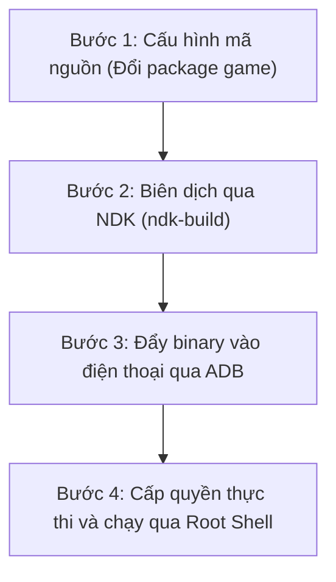

# Hướng Dẫn Kỹ Thuật: Quy Trình Biên Dịch & Khởi Chạy Dự Án Android NDK Overlay (Vulkan)

Tài liệu này hướng dẫn chi tiết từng bước từ biên dịch mã nguồn C++ trên máy tính cho đến thiết lập môi trường, đẩy file vào điện thoại Android và vận hành chương trình.

---

## 1. Yêu Cầu Thiết Bị & Môi Trường

### A. Yêu Cầu Thiết Bị Android
- **Quyền Root**: Thiết bị **bắt buộc phải có Root** (Magisk, KernelSU hoặc APatch).
  > [!IMPORTANT]
  > Dự án này không phải file APK thông thường, mà là một **tiến trình nhị phân Linux độc lập (ELF binary)**. Nó cần quyền Root (`su`) để:
  > 1. Đọc bộ nhớ tiến trình game (`process_vm_readv` / driver).
  > 2. Sử dụng `Native Surface` tạo lớp vẽ Vulkan đè trực tiếp lên SurfaceFlinger của Android.
  > 3. Mô phỏng cảm ứng ngắm bắn qua tệp thiết bị kernel `/dev/input/event*`.
- **Kiến trúc CPU**: `arm64-v8a` (hầu hết smartphone Android hiện đại).
- **Hệ điều hành**: Android 9.0 trở lên (khuyến nghị Android 10 - 14).

### B. Môi Trường Trên Máy Tính (PC)
- Đã cài đặt **Android NDK** (phiên bản r21e đến r26b).
- Đã cài đặt công cụ **ADB (Android Debug Bridge)** và bật chế độ *USB Debugging* (Gỡ lỗi USB) trên điện thoại.

---

## 2. Quy Trình 4 Bước Triển Khai



---

### Bước 1: Điều Chỉnh Cấu Hình Gói Game (Package Name)
Trước khi biên dịch, hãy đảm bảo chương trình trỏ đúng vào phiên bản game bạn đang chơi trên máy:

Mở file [src/Android_draw/其他.h](file:///c:/Users/hassk/Music/jni/src/Android_draw/其他.h) tại dòng 104:
- Nếu chơi **Hòa Bình Tinh Anh (Trung Quốc)**: giữ nguyên `"com.tencent.tmgp.pubgmhd"`.
- Nếu chơi **PUBG Mobile Quốc Tế**: đổi thành `"com.tencent.ig"`.
- Nếu chơi **PUBG Mobile VNG**: đổi thành `"com.vng.pubgmobile"`.

---

### Bước 2: Biên Dịch Bằng Android NDK

1. Mở terminal (CMD, PowerShell hoặc WSL) và chuyển vào thư mục dự án:
   ```bash
   cd "C:\Users\hassk\Music\jni"
   ```
2. Thực hiện lệnh biên dịch `ndk-build`:
   - **Nếu dùng Windows (cmd/powershell)**:
     ```cmd
     <đường_dẫn_tới_ndk>\ndk-build.cmd -B
     ```
   - **Nếu dùng Linux / WSL**:
     ```bash
     $NDK/ndk-build -B
     ```
3. **Kết quả đầu ra**:
   Sau khi hoàn tất, binary thực thi sẽ xuất hiện tại:
   `C:\Users\hassk\Music\jni\libs\arm64-v8a\和平.sh` (mặc dù có đuôi `.sh`, đây thực chất là file nhị phân Linux ELF arm64).

> [!TIP]
> Bạn có thể đổi tên file này thành tên ngắn gọn dễ gọi (ví dụ: `overlay` hoặc `fh_tool`).

---

### Bước 3: Đẩy File Vào Điện Thoại Android

Kết nối điện thoại với máy tính qua cáp USB, đảm bảo lệnh `adb devices` nhận diện thiết bị.

1. **Tạo các thư mục cấu hình tùy chọn trên thẻ nhớ** (nếu cần dùng cờ tính năng):
   - Chạy ẩn không cần giữ terminal:
     ```bash
     adb shell "touch /sdcard/无后台"
     ```
   - Chống quay/chụp màn hình menu:
     ```bash
     adb shell "touch /sdcard/防录屏"
     ```

2. **Đẩy file binary vào thư mục tạm có quyền thực thi (`/data/local/tmp/`)**:
   ```bash
   adb push libs/arm64-v8a/和平.sh /data/local/tmp/overlay
   ```

3. **Cấp toàn quyền thực thi (chmod)**:
   ```bash
   adb shell "su -c chmod 777 /data/local/tmp/overlay"
   ```

---

### Bước 4: Khởi Chạy Chương Trình Trên Thiết Bị

Có 2 cách để vận hành:

#### Cách 1: Vận hành trực tiếp từ Máy tính (qua ADB)
1. Mở game trên điện thoại và đăng nhập vào sảnh chờ.
2. Trên máy tính, gõ lệnh kích hoạt:
   ```bash
   adb shell "su -c /data/local/tmp/overlay"
   ```
3. Quan sát màn hình điện thoại: Overlay Vulkan sẽ khởi tạo và menu ImGui sẽ hiển thị đè lên màn hình game.

#### Cách 2: Vận hành độc lập trên Điện thoại (Dùng ứng dụng Termux)
Không cần máy tính, bạn có thể chạy bất kỳ lúc nào ngay trên điện thoại:
1. Cài đặt app **Termux** trên điện thoại (tải từ F-Droid hoặc GitHub).
2. Mở Termux và gõ:
   ```bash
   su
   /data/local/tmp/overlay
   ```
3. Sau khi khởi chạy, nếu đã có file `/sdcard/无后台`, tiến trình sẽ tự động tách nền chạy ngầm và bạn có thể vào game trải nghiệm.

---

## 3. Các Lỗi Thường Gặp & Cách Khắc Phục

| Hiện Tượng Lỗi | Nguyên Nhân Gốc | Giải Pháp Xử Lý |
| :--- | :--- | :--- |
| `Permission denied` khi chạy | Chưa cấp quyền thực thi hoặc chưa gọi quyền `su` | Chạy lệnh `chmod 777 /data/local/tmp/overlay` và luôn bắt đầu lệnh bằng `su -c` |
| `和平精英未启动` (Game chưa chạy) | Package name trong code không khớp với bản game trên máy | Kiểm tra lại package name tại `其他.h:104` (VNG, Quốc tế hay bản Trung) |
| Lỗi khởi tạo Vulkan (`init_vulkan failed`) | Xung đột độ phân giải hoặc driver màn hình | Kiểm tra lại hàm `screen_config()` trong `main.cpp`, đảm bảo xoay ngang màn hình game trước khi chạy |
| Không đọc được bộ nhớ / Đứt crash | Kernel chặn `process_vm_readv` hoặc thiếu driver | Kiểm tra quyền Root đã cấp cho Shell/Termux trong Magisk/KernelSU chưa |
